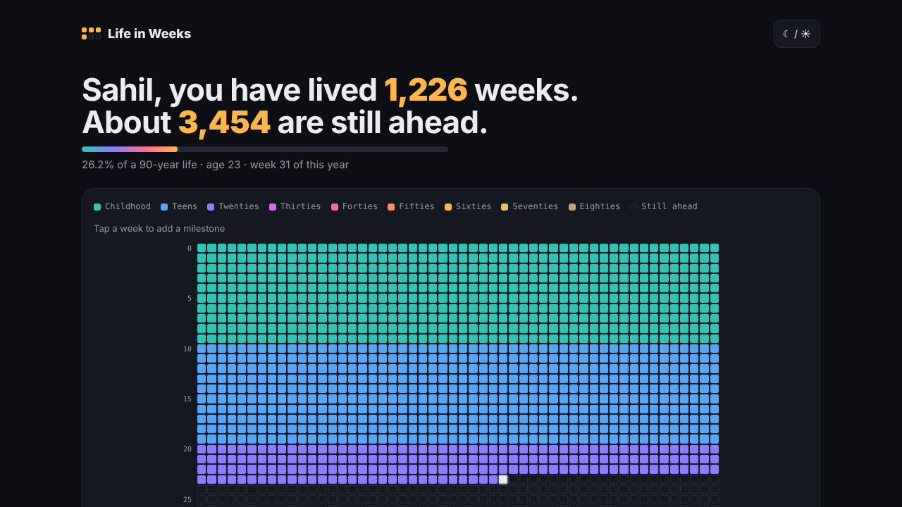

<div align="center">

# Life in Weeks

**Your whole life on one page. Every box is one week.**

An average life is about 4,000 weeks. How many have you lived, and what will you do with the rest?

### [▶ Try it live](https://sahil-zaini.github.io/life-in-weeks/)



</div>

---

## What it does

- 🟩 **Your life as a grid.** 52 boxes per row, one row per year, coloured by decade from teal childhood to golden old age. This week pulses.
- 📊 **Your life in numbers.** Days lived, sunsets seen, full moons, Ramadans, heartbeats and breaths, plus the weekends, birthdays and summers still ahead.
- ⭐ **Milestones.** Tap any week to mark it: born, first school day, first job, wedding, first company…
- 🖼️ **Download as an image.** A clean poster of your life, ready for Instagram, WhatsApp or LinkedIn.
- 🔗 **Share link.** Your whole life, milestones included, is stored in the link itself, so anyone who opens it sees exactly what you see.
- 🌗 **Light and dark mode**, and it works on any phone.
- 🔒 **Private by design.** No server, no account and no tracking. Nothing leaves your browser.

## Run it yourself

It's one HTML file, with nothing to install.

```bash
git clone https://github.com/sahil-zaini/life-in-weeks.git
cd life-in-weeks
open index.html        # or just double-click it
```

### Host it free on GitHub Pages

Repo **Settings → Pages → Source: Deploy from a branch → `main` / root → Save**. About a minute later it's live at `https://<your-username>.github.io/life-in-weeks/`.

## How the grid is counted

Each row starts on your birthday. Week 1 is the first seven days after your birthday, and week 52 also holds the last day or two of the year, so every row is exactly 52 boxes. People born on 29 February get their birthday on 28 February in other years.

## Ideas welcome

- [ ] Countries lived in, shown as colour bands
- [ ] Compare two lives side by side
- [ ] Print-ready A3 poster

Open an issue or a pull request, and a ⭐ helps others find it.

## Inspiration

Based on the idea from Tim Urban's essay *"Your Life in Weeks"* (Wait But Why, 2014).

## License

MIT © Sahil Zaini

<sub>Designed &amp; Developed by Sahil Zaini / Zaini Developers · Powered by YCS Trust</sub>
